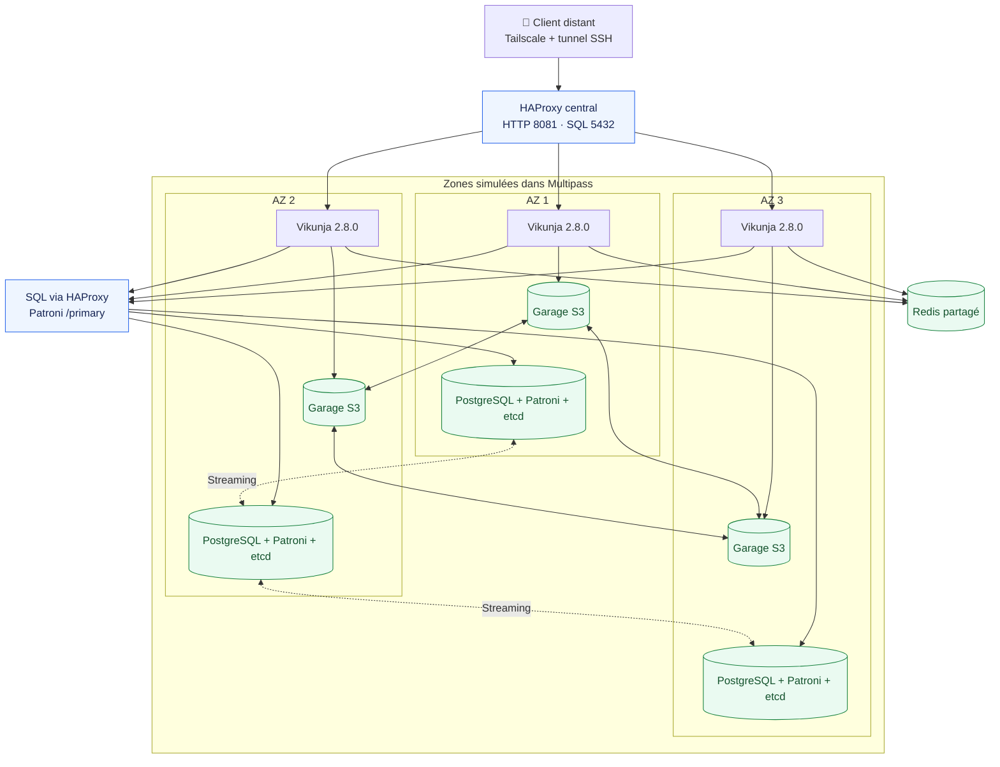

# Multi-AZ High Availability Homelab

### Proxmox · Multipass · PostgreSQL/Patroni · etcd · HAProxy · Garage S3 · Vikunja · Redis

> **Projet personnel d'ingénierie infrastructure et cloud** — trois zones de disponibilité **simulées**, tests de panne réels, basculement automatique de PostgreSQL et stockage objet distribué.
>
> **Campagne de validation :** 21 et 23 novembre 2026. **Statut :** preuve de concept fonctionnelle ; quelques limites connues restent documentées.

## Objectif

Concevoir une plateforme de tâches web répartie sur trois zones, capable de continuer à fonctionner lors de la perte simulée d'une zone et de rétablir automatiquement les écritures après la perte du **Primary PostgreSQL**.

Le laboratoire comporte **six VM Multipass** (trois applicatives et trois bases) hébergées par une **même VM Ubuntu sur un seul hôte Proxmox**. Il s'agit d'une **simulation multi-AZ**, pas de trois datacenters réellement indépendants.

## Architecture d'ensemble

**Voir le [schéma détaillé des flux et de la topologie](docs/ARCHITECTURE.md) et le [diagramme de séquence du failover SQL](docs/FAILOVER-SEQUENCE.md).**

## Stack et rôle des composants

| Couche | Composant | Rôle |
|---|---|---|
| Hyperviseur | Proxmox | Hébergement du laboratoire |
| Zones virtuelles | Multipass sur Ubuntu | 3 zones et 6 VM |
| Application | Vikunja 2.8.0 | Trois instances stateless avec données partagées |
| Répartition | HAProxy 3.2.26 | Round-robin HTTP et sélection du Primary SQL |
| Données relationnelles | PostgreSQL 16.15 | Trois nœuds répliqués |
| Orchestration DB | Patroni + etcd | Élection et contrôle de santé du Primary |
| Stockage objet | Garage S3 2.5.0 | 3 nœuds, facteur de réplication 3 |
| État partagé | Redis 8.2.11 | Store commun applicatif |
| Administration | Tailscale + SSH | Accès distant au réseau privé |

## Résultats observés

| Expérience | Résultat | Interprétation |
|---|---|---|
| Répartition HTTP après recette finale | **407 requêtes** : AZ1 137, AZ2 134, AZ3 136 | Répartition équilibrée |
| Erreurs HTTP 5xx dans les logs de cette recette | **0 observée** | Recette finale sans erreur 5xx détectée |
| Perte d'AZ1 | **9/9 API HTTP 200** | Continuité des endpoints testés |
| Lecture S3 pendant perte d'AZ1, essai parallèle | **6/6 lectures OK**, contenu identique | Résilience démontrée pour l'objet testé |
| Lecture S3 pendant perte d'AZ1, essai précédent | **3 timeouts AZ2**, puis 3 succès AZ3 | Incident intermittent **non résolu** |
| Perte d'AZ2, alors Primary SQL | **AZ3 promue**, détectée après **36 s** | Basculement automatique observé |
| Écritures SQL après promotion | Un premier échec, puis **INSERT temporaire réussi** | Reprise, pas zéro interruption |
| Ancien Primary AZ2 réintégré | **Replica**, timeline 4, lag affiché 0 Mo | Cluster reconstitué |

**Précision :** les 36 secondes correspondent au temps écoulé avant la **détection** du nouveau Primary par notre script, pas à un RTO complet mesuré côté navigateur. Les requêtes HTTP après failover ne prouvent pas l'absence d'erreurs pendant l'élection.

## Documentation

| Document | Contenu |
|---|---|
| [Architecture](docs/ARCHITECTURE.md) | Schéma Mermaid, flux, composants, frontières de panne |
| [Réseau](docs/RESEAU.md) | Zones, interfaces, ports, accès Tailscale |
| [Séquence de basculement](docs/FAILOVER-SEQUENCE.md) | Panne du Primary SQL et reconvergence HAProxy |
| [Campagne de tests](docs/TESTS-ET-RESULTATS.md) | Conditions, résultats réels et réserves |
| [Incident Garage S3](docs/INCIDENT-GARAGE-S3.md) | HTTP 504, timeouts, hypothèses, mesures suivantes |
| [Runbook d'exploitation](docs/EXPLOITATION.md) | Santé, démarrage, arrêt, récupération |
| [Sécurité](docs/SECURITE.md) | Gestion des secrets et règles de publication |
| [Limites et roadmap](docs/LIMITES-ET-ROADMAP.md) | SPOF, observabilité, HA physique |
| [Import des scripts source](docs/IMPORT-SOURCES.md) | Méthode sûre pour intégrer les originaux du serveur |
| [Première maquette Flask](examples/legacy-flask/README.md) | Premiers essais de répartition HTTP et configurations de référence |
| [Guide de reconstruction](docs/GUIDE-DE-RECONSTRUCTION.md) | Étapes, commandes de vérification et explications techniques |
| [Inventaire des originaux exclus](docs/ORIGINAUX-EXCLUS.md) | Scripts privés non publiés et travaux restants |

## Scripts et configurations

Les [configurations de référence](examples/) présentent le routage HAProxy, un service Vikunja et la première maquette Flask. Les scripts [check-health-readonly.sh](scripts/check-health-readonly.sh), [check-http-health.sh](scripts/check-http-health.sh) et [test-garage-s3.sh](scripts/test-garage-s3.sh) servent aux vérifications ; le dernier **écrit et supprime un objet** dans un bucket de test.

Pour comprendre la construction et la remise en service, consulter le [guide de reconstruction](docs/GUIDE-DE-RECONSTRUCTION.md). Les configurations sont fournies comme références : elles nécessitent une adaptation à l'environnement et ne constituent pas une installation automatique complète.

## Transparence technique

**Points de défaillance uniques :** hôte Proxmox, HAProxy central et Redis central. Aucune garantie de disponibilité en cas de panne physique de l'hôte. Le premier essai Garage sous panne d'AZ1 a produit des timeouts ; le second a réussi, sans que la cause des premiers échecs soit définitivement établie.

**Code publié :** configurations de référence et scripts de contrôle. Les scripts d'administration originaux, les données persistantes et les identifiants du laboratoire ne figurent pas dans ce dépôt.

## Références

[Patroni](https://patroni.readthedocs.io/) · [HAProxy](https://docs.haproxy.org/) · [Garage](https://garagehq.deuxfleurs.fr/documentation/) · [Vikunja](https://vikunja.io/docs/) · [Tailscale](https://tailscale.com/kb/1019/subnets)

---

*Homelab éducatif et technique, pas une infrastructure de production ni une promesse de SLA.*
