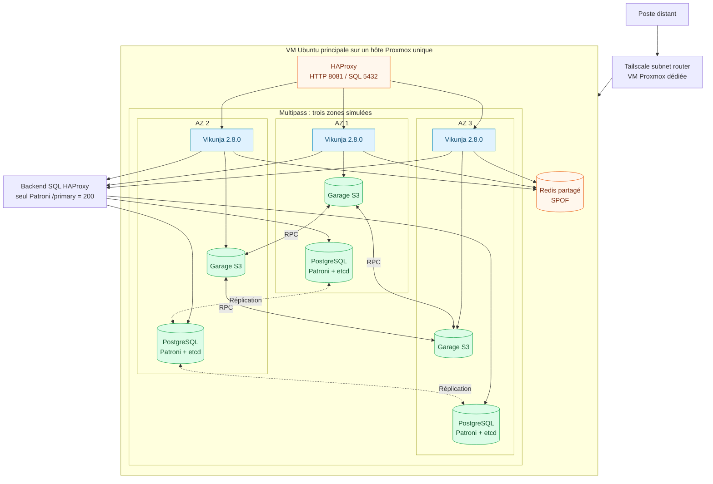

# Architecture technique et flux

## 1. Vue logique

Le schéma isole les **services partagés** des trois zones simulées. Les chemins SQL et S3 sont distincts : HAProxy prend les décisions SQL, Garage gère la réplication des objets.

> ⚠️ Trois zones virtuelles ne signifient pas trois zones physiques. L'hôte Proxmox, Redis et HAProxy restent des points de défaillance uniques.

## 2. Inventaire

| Zone | Réseau simulé | VM application | VM base de données |
|---|---|---|---|
| AZ1 | `10.97.0.0/24` | `vm-az1` | `db-az1` |
| AZ2 | `10.97.1.0/24` | `vm-az2` | `db-az2` |
| AZ3 | `10.97.2.0/24` | `vm-az3` | `db-az3` |

Trois Vikunja partagent **une même base**, **le même secret applicatif**, **un Redis** et **un bucket S3**. Chaque Vikunja parle à son Garage local pour les objets. Les nœuds Garage échangent entre eux pour assurer la réplication sur les zones.

## 3. Chemins critiques

- **HTTP** : client → HAProxy (round-robin) → l'une des trois applications.
- **SQL** : application → HAProxy SQL → seul nœud Patroni dont `/primary` répond HTTP 200.
- **Pièces jointes** : application → endpoint Garage S3 → réplication interne entre trois zones.
- **Cache partagé** : chaque instance applicative → Redis central.
- **Consensus** : Patroni et etcd suivent l'état du cluster et l'élection du Primary.

## 4. Haute disponibilité SQL

Après perte d'AZ2, ancien Primary, le laboratoire a observé une promotion d'AZ3. Au retour d'AZ2, AZ3 est restée Leader et AZ2 a rejoint comme Replica sur la **timeline 4**, avec un retard affiché de 0 Mo. HAProxy possède `on-marked-down shutdown-sessions` pour fermer des sessions vers un backend devenu indisponible.

Le basculement n'est **pas transparent à toutes les connexions** : une première tentative SQL a été fermée, puis la suivante a réussi.

## 5. Stockage Garage

Trois nœuds Garage 2.5.0, zones distinctes, réplication configurée à trois copies. Un test parallèle de lecture sous panne d'AZ1 a été réussi **6 fois sur 6**, mais un essai antérieur avait produit des timeouts et des HTTP 504. Voir [l'incident](INCIDENT-GARAGE-S3.md).

## 6. Dimensionnement et limites

Ce projet ne démontre ni résilience inter-datacenters, ni quorum en cas de partition prolongée, ni tolérance à la panne de l'hôte physique. Les applications continuent à utiliser des dépendances centrales hors des zones. Voir [roadmap](LIMITES-ET-ROADMAP.md).
