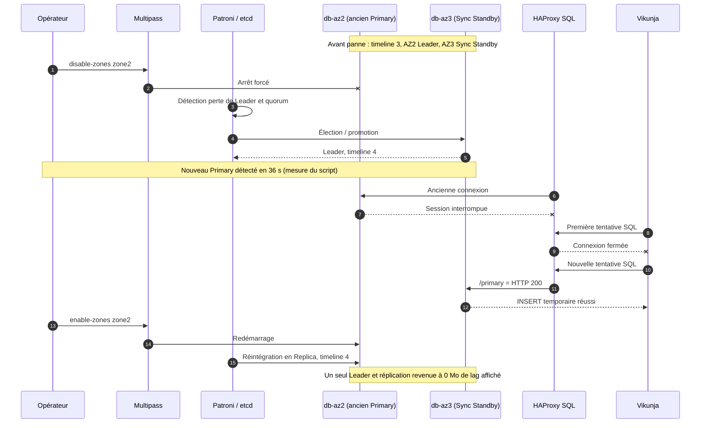

# Basculement PostgreSQL : panne du Primary AZ2

## Diagramme de séquence

## Mesures et nuances

- **36 secondes** : temps entre coupure et détection du nouveau Primary par le script, pas un RTO utilisateur garanti.
- **Une erreur transitoire SQL** observée avant succès de la transaction suivante.
- **9/9 HTTP 200** sur `/api/v1/info` après la détection de la promotion.
- Après restauration : db-az3 Leader ; db-az1 Sync Standby ; db-az2 Replica ; tous en timeline 4.
- Les vérifications finales de tâches et d'envoi de TXT/PNG ont eu lieu **après** le failover, pas durant les 36 secondes de transition.

La preuve est reproductible uniquement dans le périmètre exact de ce laboratoire. Aucune suppression ou reconstruction forcée des volumes n'a été nécessaire.
